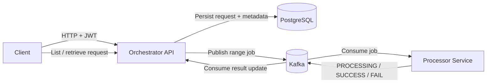

# Architecture Overview

This document describes the current architecture of the Prime Number Generator system as implemented in this repository. It is intentionally aligned with the project documentation and the actual Java modules in the workspace rather than with a generic template.

## 1. Project Structure

The repository is organized as a small event-driven system with a React frontend
and two Java services:

```text
/
├── README.md
├── ARCHITECTURE.md
├── compose.yaml
├── prime-number-generator-frontend/
│   ├── Dockerfile
│   ├── .dockerignore
│   ├── nginx.conf
│   └── src/
├── examples/
│   └── processing-result-updates/
│       ├── processing.json
│       ├── success.json
│       └── fail.json
├── prime-number-generator-orchestrator/
│   ├── Dockerfile
│   ├── HELP.md
│   ├── README.md
│   ├── mvnw
│   ├── pom.xml
│   └── src/
│       ├── main/
│       │   ├── java/com/example/orchestrator/
│       │   │   ├── application/
│       │   │   ├── domain/
│       │   │   ├── infrastructure/
│       │   │   ├── presentation/
│       │   │   └── PrimeNumberGeneratorOrchestratorApplication.java
│       │   └── resources/application.properties
│       └── test/java/com/example/orchestrator/
├── prime-number-generator-processor/
│   ├── Dockerfile
│   ├── HELP.md
│   ├── README.md
│   ├── mvnw
│   ├── pom.xml
│   └── src/
│       ├── main/
│       │   ├── java/com/example/processor/
│       │   │   ├── application/
│       │   │   ├── domain/
│       │   │   ├── infrastructure/
│       │   │   ├── presentation/
│       │   │   └── PrimeNumberGeneratorProcessorApplication.java
│       │   └── resources/application.properties
│       └── test/java/com/example/processor/
└── .gitignore
```

The repository does not use a monolith. Instead, it separates responsibilities in the same way the current code already does:

- Orchestrator: public API, request lifecycle, persistence, security, Kafka publication, and result update handling.
- Processor: internal worker that consumes range jobs and emits processing updates.
- Frontend: React client for signing in and managing prime-generation requests.

## 2. High-Level System Diagram



The orchestrator is the system owner of the request lifecycle. The processor is intentionally isolated from the public API and works via Kafka messages. The client never waits for the full prime computation to finish.

## 3. Core Components

### 3.1. Orchestrator Service

Name: Prime Number Generator Orchestrator

Description:
- Exposes the authenticated REST API for creating, retrieving, and listing prime-generation requests.
- Persists a `PrimeRequests` record and a related `ProcessingResults` record in PostgreSQL.
- Uses the authenticated JWT `sub` claim as the owner identifier for every request.
- Publishes each range to Kafka using the processing-result UUID as the message key.
- Consumes processing-result updates from Kafka and persists the new state in the same request lifecycle.

Key packages:
- `application/services`: `PrimeRequestService`, `ProcessingResultUpdateService`
- `application/dtos`: `PrimeNumberRangeMessage`, `ProcessingResultUpdateDTO`, `PrimeRequestDTO`
- `domain/entities`: `PrimeRequests`, `ProcessingResults`, enums for request status and processing state
- `infrastructure/messaging`: `KafkaPrimeRequestMessageProducer`, `ProcessingResultKafkaConsumer`
- `infrastructure/repositories`: JPA adapters around the persistence layer
- `presentation/controllers`: `PrimeRequestController` and exception handling

Technologies:
- Java 25
- Spring Boot 4.1.0
- Spring Web MVC
- Spring Data JPA
- Spring Kafka
- Spring Security OAuth2 Resource Server
- PostgreSQL
- Springdoc OpenAPI

### 3.2. Processor Service

Name: Prime Number Generator Processor

Description:
- Consumes generation jobs from the Kafka request topic.
- Uses the Kafka key as the processing-result UUID to correlate all updates for one job.
- Emits `PROCESSING`, `SUCCESS`, or `FAIL` updates to the result topic.
- Executes the expensive prime-generation work without exposing a public HTTP interface.

Key packages:
- `presentation/messaging`: `PrimeNumberRequestKafkaConsumer`
- `application/services`: `PrimeGenerationService`
- `application/dtos`: `ProcessingResultUpdateDTO`
- `domain/pojos`: `PrimeGenerator`
- `infrastructure/messaging`: `KafkaProcessingResultUpdateProducer`

Technologies:
- Java 25
- Spring Boot 4.1.0
- Spring Kafka
- Jackson for JSON payload handling

## 4. Request Lifecycle and Business Rules

The current implementation clearly separates request status from processing state.

- `PrimeRequestStatus`: `PENDING`, `PROCESSING`, `COMPLETED`
- `ProcessingResultState`: `IN_QUEUE`, `PROCESSING`, `SUCCESS`, `FAIL`

Lifecycle:
1. Client submits a range and an authenticated JWT.
2. Orchestrator validates the range and owner.
3. The request is created as `PENDING` with an associated processing result in `IN_QUEUE`.
4. Orchestrator sends the range to Kafka with the processing-result UUID as the key.
5. Processor consumes the job and publishes `PROCESSING`.
6. Processor calculates primes and publishes either `SUCCESS` or `FAIL`.
7. Orchestrator updates the request status to `PROCESSING` or `COMPLETED` depending on the arrived processing outcome.

This distinction keeps the business workflow separate from the computation outcome. A request can be `COMPLETED` while the processing result ends in `FAIL`.

## 5. Data Model

### 5.1. PostgreSQL

The primary persistence layer is PostgreSQL, configured through the root Compose stack.

Relevant domain entities:
- `PrimeRequests`
  - `id` (UUID)
  - `ownerId` (authenticated JWT `sub`)
  - `inputNumberMin`
  - `inputNumberMax`
  - `status`
  - `createdAt`
  - `updatedAt`
  - `results` (one-to-one with `ProcessingResults`)
- `ProcessingResults`
  - `id` (UUID)
  - `state`
  - `startedAt`
  - `finishedAt`
  - `results` (JSON array of `BigInteger` values)
  - `errorMessage`

These tables are mapped by Spring Data JPA and created/updated through `ddl-auto=update` in the orchestrator configuration. The current implementation stores data for the request lifecycle and the processing metadata needed to expose results to the client.

## 6. Kafka Contracts

### 6.1. Topics and message keys

The project configures two topics by default:

- `prime-number-requests`
- `prime-number-results`

Both are configured from environment variables and default to the values above. The Kafka key for each message is the processing-result UUID generated by the orchestrator.

### 6.2. Request topic payload

The orchestrator publishes a JSON payload shaped like:

```json
{
  "inputNumberMin": 0,
  "inputNumberMax": 100
}
```

The processor reads this payload and calculates the appropriate primes.

### 6.3. Result topic payload

The processor emits `ProcessingResultUpdateDTO` values with the following states:

- `PROCESSING`: requires `startedAt`
- `SUCCESS`: requires `results` and `finishedAt`
- `FAIL`: requires `errorMessage` and `finishedAt`

The examples in `examples/processing-result-updates/` reflect the actual contract used by the project. The orchestrator intentionally rejects invalid lifecycle transitions, such as `IN_QUEUE` updates or illegal state changes.

## 7. Security and API Rules

The orchestrator is the only service exposing a public API, and all routes require a valid JWT bearer token.

Current security model:
- Spring Security OAuth2 Resource Server validates the issuer defined by `OAUTH2_ISSUER_URI`.
- Request ownership is derived from the JWT `sub` claim and cannot be overridden by the client.
- Requests are scoped to the authenticated user: a missing request or a request belonging to another user responds with `404 Not Found`.
- Swagger endpoints are public; the API itself is protected.

Current API behavior:
- `POST /api/v1/prime-requests`: creates a request and returns the new UUID.
- `GET /api/v1/prime-requests/{id}`: retrieves a single request owned by the authenticated user.
- `GET /api/v1/prime-requests?page=0&size=20`: lists paginated user-scoped results.

The validation rules implemented in the domain model enforce non-negative ranges and a range width between 10 and 1,000 inclusive.

## 8. Deployment and Infrastructure

The repository includes Docker Compose for the local environment:

```yaml
services:
  postgres
  kafka
  kafka-ui
  orchestrator
  processor
```

Configuration details from the current Compose file:
- PostgreSQL at `localhost:5432` on the host, using the `postgres_data` volume.
- Kafka at `localhost:29092` on the host and `kafka:9092` from containers.
- Kafka UI at `http://localhost:8081`.
- Orchestrator at `http://localhost:8080`.
- Processor starts as a worker after Kafka is healthy.

The application configuration uses environment variables rather than hard-coded credentials; default values are intended for local development only.

## 9. Architectural Decisions and Current Status

The implementation reflects the following decisions, which are already visible in the code:

- Event-driven flow is intentional: the public API does not block on prime calculation.
- The orchestrator owns the request lifecycle and acts as the authoritative state holder.
- The processor is intentionally compute-only and independent from the HTTP layer.
- Kafka is used as the coordination boundary between services.
- Business rules and validation remain in the domain/application layers, with infrastructure concerns isolated in adapters and configuration.
- The project is still a demonstration design: no autoscaling policy, production audience validation, or deployment-specific hardening is configured.

## 10. Project Identification

Project Name: Prime Number Generator System

Repository URL: https://github.com/CarlosEduM/prime-number-generator

Primary Contact / Team: Not defined in the repository metadata

Date of Last Update: 2026-11-17

## 11. Glossary / Acronyms

[API]: Application Programming Interface

[DTO]: Data Transfer Object

[HTTP]: Hypertext Transfer Protocol

[JWT]: JSON Web Token

[Kafka]: Apache Kafka, a distributed streaming platform

[JPA]: Java Persistence API

[REST]: Representational State Transfer

[Spring Boot]: Java framework used to build the application services

[Maven]: Build and dependency management tool
