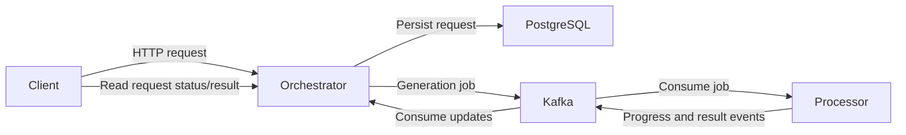

# Prime Number Generator System

This repository is a demonstration project for designing systems that need to
handle long-running work without keeping a client's request open until that
work is finished. Prime-number generation is used as an example of a
computationally expensive task; the focus is on system design, not on providing
a production-grade prime-number library.

The system is split into an **orchestrator**, which owns the client-facing API
and request lifecycle, and a **processor**, which is intended to perform the
calculation independently.

## Architecture at a glance



The orchestrator records the request, publishes a job to Kafka, and returns a
request ID without waiting for the calculation to finish. The processor
reports progress and the final outcome as events. The orchestrator stores
those updates so clients can check the request later. The HTTP call waits for
the initial Kafka publish to complete, but not for prime generation.

## Why these design choices

### Event-driven communication with Kafka

The project demonstrates an event-driven approach for workloads that may take
significant time to complete. A queue separates request acceptance from
calculation: incoming work can wait in Kafka while processors handle earlier
jobs. This helps the API remain responsive during long calculations and lets
the API and workers scale independently.

Kafka also provides a boundary between services: the orchestrator and
processor coordinate through message keys and payloads rather than a direct,
synchronous call. Queue-based automatic scaling is possible when the
deployment platform is configured with an autoscaling policy and the Kafka
topic has enough partitions; this repository does not configure such a policy.

### A separate processing microservice

The processor is intended to be an internal worker, isolated from the client's
HTTP request. This keeps CPU-intensive work from occupying the API request
lifecycle and allows processing capacity to be adjusted independently:

- **Vertical scaling** can assign more CPU and memory to worker instances.
- **Horizontal scaling** can add worker instances to process jobs in parallel,
  subject to Kafka consumer-group and partition limits.
- The worker could be implemented in another language, such as Go, without
  changing the client-facing API, provided it continues to honor the Kafka
  message contract.

The brute-force prime-generation approach is intended to simulate a slow
process. A run taking around 30 minutes is a design scenario, not a measured
runtime guarantee. The processor implementation is currently a bootstrap
skeleton; see its README for details.

### Layered architecture

The orchestrator separates presentation, application, domain, and
infrastructure concerns. Business rules and use cases depend on application
interfaces and domain concepts rather than directly on Spring, Kafka, or
PostgreSQL APIs. Infrastructure adapters connect those interfaces to the
chosen frameworks and external systems.

Spring Boot is a common Java platform, but keeping these boundaries still
preserves options. For example, replacing Kafka with another message broker
or PostgreSQL with a non-relational database would require new or modified
infrastructure adapters and configuration, while the domain rules and
application use cases can remain unchanged. The same principle allows the
processor implementation to use a different programming language while
preserving the agreed message contract.

### Trade-offs and when this architecture fits

These choices have real costs. A multi-service, event-driven system introduces
more moving parts to build, configure, test, deploy, monitor, and troubleshoot.
It increases development time and requires stronger technical knowledge of
messaging, distributed systems, and operations. Before adopting this
architecture, weigh those costs against the expected benefits.

For an application with few users and modest response-time requirements, a
monolith that accepts a request and handles the work asynchronously in the
background may be sufficient. Kafka and a separate processor are not goals in
themselves; they are useful when independent scaling, workload isolation, or
service boundaries justify their added complexity.

This design aims to make capacity adaptable as demand changes, but it does not
support an unlimited number of users just by adding hardware. Actual capacity
depends on available resources and on tuning the API, worker count, Kafka
partitions, database, and other infrastructure. The current database design
and configuration are for demonstration; I would not recommend them for an
application with more than 500,000 users without further design review and
load testing. That figure is a conservative project-specific recommendation,
not a measured capacity limit.

The benefit of the current boundaries is that the system can evolve without
requiring every change to affect every service or business rule. Adapters,
configuration, and message contracts may still need to change when replacing a
technology, but the code is structured to make those changes quicker and more
localized than if framework and infrastructure details were spread throughout
the application.

## Repository layout

```text
prime-number-generator-orchestrator/  Client API, request lifecycle, persistence, Kafka integration
prime-number-generator-processor/     Internal processing worker (currently a skeleton)
examples/                             Example Kafka result-update payloads
compose.yaml                          Local PostgreSQL, Kafka, Kafka UI, and orchestrator
```

For service-specific behavior and contracts, see:

- [Orchestrator README](./prime-number-generator-orchestrator/README.md)
- [Processor README](./prime-number-generator-processor/README.md)

## Quick start

### Requirements

- Docker with the Docker Compose plugin.
- Java 25 and the included Maven Wrapper scripts if building or testing a
  service outside Docker.

### Start the local stack

From the repository root, run:

```bash
docker compose up --build
```

Compose starts:

- the orchestrator API at `http://localhost:8080`;
- PostgreSQL, with data stored in the `postgres_data` volume;
- a local Kafka broker, available at `localhost:29092` from the host and
  `kafka:9092` from other Compose containers;
- Kafka UI at `http://localhost:8081`.

The database port is not exposed on the host. The Compose setup configures the
orchestrator to use `https://accounts.google.com` as its JWT issuer. API
requests require a valid bearer token from that issuer. Swagger UI is available
at `http://localhost:8080/swagger-ui/index.html`.

The Compose stack does **not** currently start a processor. The processor
module does not yet consume Kafka jobs or publish result updates, so requests
can be accepted and queued, but will not complete through the full workflow
until a processor is implemented and connected.

Compose uses development database credentials by default. Override them before
starting the stack when needed:

```bash
DB_USERNAME=myuser DB_PASSWORD=my-local-password docker compose up --build
```

These defaults and the issuer setup are for local demonstration only. Issuer
validation alone does not restrict tokens to a specific OAuth client audience;
configure audience validation and production-grade secrets and transport
security before using the system in a deployed environment.

Stop the containers with:

```bash
docker compose down
```

The PostgreSQL volume is retained when the containers stop.

### Run tests

Each service is a separate Maven project. Run its tests from the corresponding
module directory:

```bash
cd prime-number-generator-orchestrator
./mvnw test
```

```bash
cd prime-number-generator-processor
./mvnw test
```

## API and message contracts

The orchestrator API requires authentication and exposes operations to create,
retrieve, and list a user's prime-generation requests. Its detailed endpoints,
validation rules, configuration, and Kafka payloads are documented in the
[Orchestrator README](./prime-number-generator-orchestrator/README.md).

The processor's intended Kafka workflow, scaling considerations, dependencies,
and current implementation status are documented in the
[Processor README](./prime-number-generator-processor/README.md).
